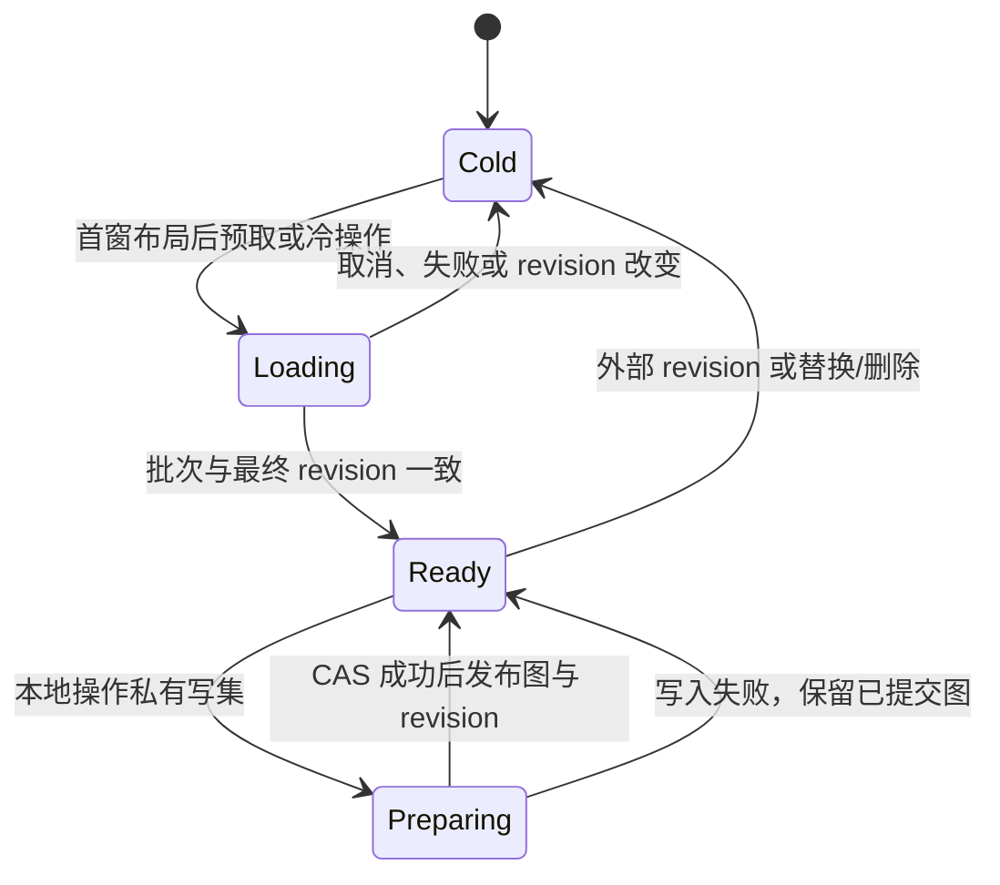

# 会话行模型与分页展示

会话的持久化和业务接口由独立 header、thread 关系、消息正文、控制投影及 revision 组成。每个 thread 有稳定身份、选中路径和自己的压缩边界；会话保存 activeThreadId。完整 `Session` 只出现在历史文件解析输入边界。

## 数据流

| 层 | 入口 | 责任 |
| --- | --- | --- |
| 业务 | `SessionService`、Chat/Thread/Fork/Naming services | 将用户操作转换成局部行命令，发布提交事件 |
| 一致性 | `SessionWriteCoordinator`、`SessionRowWriteQueue` | 串行化本宿主写入、维护生命周期；仓库 revision/CAS 处理外部并发 |
| 存储 | `RowBackedSessionRepository`、SQL/IndexedDB/Memory row store | 局部关系与正文事务、元信息投影、迁移和恢复 |
| React | `SessionQueryBridge`、`SessionTranscriptWindowController` | 分离查询、投影已提交 delta、分页正文与共用窗口的 minimap |
| 宿主 | Renderer Virtuoso、RN FlatList | 用户输入、语义锚点、布局确认和错误反馈 |

命令只读取目标消息、所需关系和相关控制信息。文本检查点更新目标正文及必要派生信息；thread 激活通过关系和 activeThreadId 完成，消息身份保持稳定。命令持久化成功后再发布事件，元信息投影失败不能重放已经成功的正文写入。

## 正文窗口

所有 thread 按历史顺序加当前 thread 组成连续列表；一次翻页可以跨 thread 边界。RN/Capacitor 每页20条，Electron/Web每页100条。连续翻页保留已加载分页，不设置正文页数上限；明确跳转可以替换当前窗口。

| 操作 | 加载与定位 |
| --- | --- |
| 普通打开 | 最新1页，定位底部 |
| 向上/向下翻页 | 每次1页，连续保留已加载分页 |
| 返回顶部/底部 | 已加载时直接定位；否则目标边缘1页替换窗口 |
| 搜索打开 | 以目标消息为中心加载1页，并定位到目标；靠近边缘时向有数据的一侧补齐 |
| 查看 thread | 以目标 thread 首条为中心加载1页并定位，发送目标不变 |
| 切换/继续 thread | 提交激活后定位该 thread 末尾 |
| 切分支 | 保留已加载公共前缀，用新分支的1页替换分叉点之后的数据 |

分页和布局变化保持当前阅读位置，跳转使用稳定 thread/message ID；RN 优先使用 FlatList 原生维持位置能力。重新打开会话仍按最新1页处理。

消息分组在真实 thread/路径边界处结束，key 不能依赖数组下标或当前窗口尾部。布局提交、远页回收与可见锚点恢复属于一次事务；宿主不得用全历史占位高度模拟位置。

## 分支预览

点击「展开」同时显示非空备选分支卡片，保留原分支编号并按较新分支在前排列。卡片展示首条有效消息；用户消息开头的分支还展示第一条有效助手回复，其他后续消息显示数量。生成中的备选消息立即展示，结束后保留到用户收起或切换分支。切换分支收起展开区域；预览消息只读，保留停止生成和切换操作。

分支目录独立按轻量元数据分页读取并自动续页。`readSessionBranchPreview` 委托存储层统计分支局部选中路径，业务层只接收预览消息、已揭示生成消息的稳定 ID 和后续消息数量；正文按 ID 点读。SQLite 在查询内聚合，IndexedDB 在单个只读事务内沿路径累加。预览不构造完整 Session，不加载整条分支正文；预览与消息缓存通过提交 revision 更新。

## 生成与独立数据

生成以目标 thread 的选中因果路径和压缩边界构造请求，与展示窗口无关。运行态单消息缓冲、控制状态、待处理工具调用和队列身份也独立于列表。页外消息仍可流式更新、停止和完成。停止期间只对发生 revision 冲突的读取做有界重试，不重放终态写入。

发送和压缩先在关系及消息 facts 上应用实际设置的上下文条数限制，再读取选中的正文；当前输入、工具续写目标和压缩摘要边界按各自语义计入。无限上下文是显式设置，不能把先读取全部正文再截断作为有限上下文的实现。

Token 使用独立选择计划、缓存和分批任务，首窗可交互之后启动历史工作。Minimap 从正文窗口已加载消息生成最多300字符的预览，按用户消息及同 thread 首条有效助手回复组合；翻页、首尾跳转、加载和错误状态共用正文 controller。点击已加载的 minimap 消息直接定位；窗口翻页、裁剪或切换时同步更新预览，不额外持久化或查询导航数据。

工作区附件检查读取选中路径的文件和图片引用 facts；附件归属清理读取所有 thread 与分支的归属 facts，完整扫描成功后才执行重新绑定和删除。Artifact 在打开预览或全屏时才读取目标祖先的 Markdown 流，只保留所需代码块和最终 HTML；关闭的预览卡片不加载历史正文。

## 历史数据与全局任务

- 初次升级解析旧 JSON，修复受支持的身份/分支/摘要关系后生成候选行；发布前验证，失败保留原始输入并报告阶段。
- 未发布候选可以从原始输入重建；已发布行数据始终权威，外层旧记录不能覆盖它。
- 本地升级与会话复制写入隔离候选，验证完成后原子发布。未知或损坏形状明确失败，不进入完整 Session 兼容运行时。
- 单会话输出、复制、搜索和资源扫描消费行或轻量分页，不构造完整 Session/SessionTree。附件归属不确定时保留资源，避免误删。
- Header、正文窗口、Token 和会话列表分别管理生命周期和缓存；minimap 跟随正文窗口；删除及重新创建同 ID 必须清除旧任务和写入栅栏。

### 发布兼容性与存储结构

正式版本兼容边界为 `v1.23.5`。旧整会话 JSON 通过兼容转换生成行候选并原子发布；备份 V1/V2 仍经过共享转换。已存在有效行提交时，`session:<id>` 旧记录保持不变；删除会话先删除旧记录，再删除行数据。行格式使用 `rowFormatVersion: 3` 与 `rowAuthority: 1`，显式未知版本报错并保留原数据。

IndexedDB 的 `chatbox-messages` 使用两层消息存储：`messages` 保存完整正文，`messageTree` 保存关系及紧凑 facts，主键为 `[sessionId, threadId, messageId]`，`byMessage` 唯一索引为 `[sessionId, messageId]`。树和 facts 以 `messageTree` 为权威；正文记录中的结构副本不能用于恢复树。路径成员资格和深度在读取时计算。消息兄弟顺序使用 `siblingOrder`，线程顺序使用 `threadOrder`，SQL 与备份 V3 使用相同名称。

数据库先不指定版本打开并验证形状；缺少最终布局时，在观测版本加一的单次升级事务内补齐缺失的表和索引，不复制或改写已有数据。失败整体回滚，遇到同名但形状错误的表或索引报错。新数据库直接创建最终布局；旧磁盘的 `messageMutationStage` 保留但不参与读写，新数据库不创建它。逻辑行版本、IDB 版本与会话 revision 相互独立。

共享 `ThreadLinks` 计算路径、成员资格、兄弟顺序、计数和端点。每次操作共享一个线程图，缓存最多保留四个线程。正文翻页仍按边读取有限窗口。首窗完成布局后，以 2,000 行分批预取元数据，批间让出事件循环，每批增量建图并验证 revision；最终路径准备也分批进行。冷操作显示加载状态。SQL 关系分页结合有界查询与共享线程图；搜索命中按线程分组使用 CTE，避免逐命中查询。

操作在私有写集中准备变更，持久化 CAS 成功后才推进缓存；失败不发布写集。遇到外部 revision、重导入、删除或替换会话时丢弃缓存。预取跨批读到不同 revision 时丢弃结果，后续读取按当前 revision 重载。

每个旧会话首次升级会全量读取其 thread 和消息行，在内存中转换并生成派生投影，然后按原 revision 做一次 CAS 原子行重写；外层 `session:<id>` 旧记录保持原样，供降级后的 v1.23 读取；新版附件清理不保护只被旧记录引用的附件。这次读写和临时内存随会话总数据量增长，涉及全部分支，不受正文窗口或 Token 分页大小限制；还需要候选数据及存储事务的临时空间。它可能增加大历史会话首次打开的耗时，不能用升级后的分页读取性能代表迁移成本。转换失败不发布候选；原子提交失败保留旧行。

整包备份导入、导出入口当前显示暂不可用；新 V3 和 V1/V2 文件适配见 [数据备份与恢复边界](data-backup.md)。Capacitor 与 RN 各自升级应用数据目录中的记录，不搬迁两个应用的数据目录。降级到 v1.23 后写入的内容在再次升级时不会合并，行数据仍为权威。

## 模块与验证

Renderer 入口位于 `src/renderer/stores/session/`；共享服务位于 `packages/chatbox-core/src/application/`；React 投影和窗口位于 `packages/chatbox-react/src/query/`。

回归范围包括命令/CAS正确性、正文和关系读取预算、跨thread分页、窗口回收、迟到请求、分支/摘要修复、空thread、消息格式升级及会话复制。真实宿主验证应记录页数、正文解码量、布局坐标、可见位置误差、首窗时间和Token任务开始顺序；存储测试不能代替FlashList或浏览器布局证据。

相关：[Token 数据流](../token-estimation.md)、[备份功能边界](data-backup.md)。
