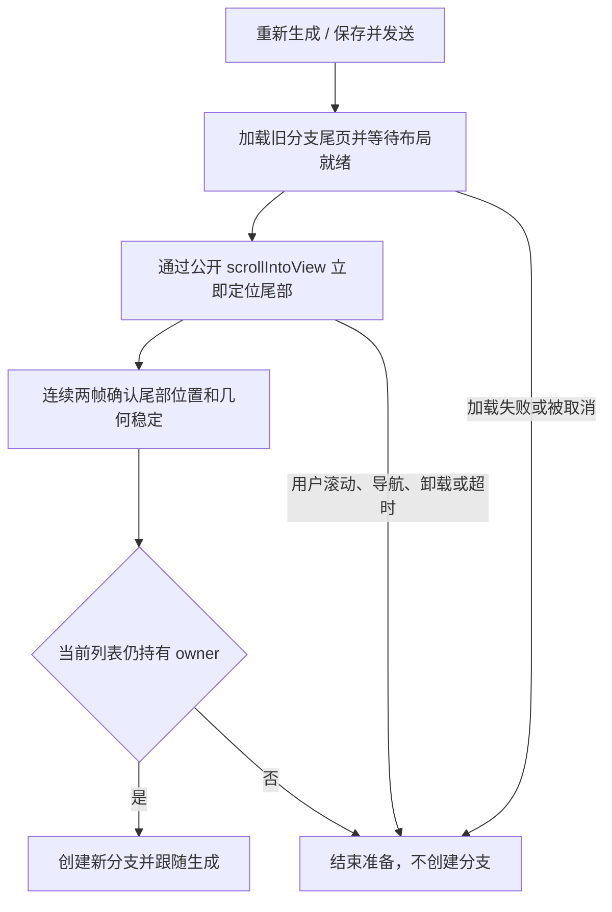

# 重新生成与编辑重发的列表跳动

> Last updated: 2026-11

## 现象与结论

在长回复中部阅读时执行“重新生成”或“保存并发送”，新分支用很短的初始回复替换旧长回复，列表高度骤减，可能出现额外跳动或连续闪烁。Electron 和 Capacitor iOS 均有用户复现。

已确认的异常位移来源是 Virtuoso 的上行尺寸补偿：它根据整份列表的高度差计算补偿，没有判断高度变化发生在阅读位置上方还是下方。独立于 Chatbox 的最小实验也能触发错误补偿，因此不是消息分组或动态行高 API 的使用错误。

产品采用的行为是：先将旧列表立即滚到底部，确认定位完成，再创建分支并跟随新回复。重新生成和编辑重发共用这一顺序。

## 为什么下方变化也会补偿

以下机制已对照当前安装的 `react-virtuoso@4.18.20` 发行包。上游对应实现见固定提交的 [upwardScrollFixSystem](https://github.com/petyosi/react-virtuoso/blob/cb6c1941d340b2d66ffeea830620cbaf7db3c3c5/packages/react-virtuoso/src/upwardScrollFixSystem.ts) 和 [stateFlagsSystem](https://github.com/petyosi/react-virtuoso/blob/cb6c1941d340b2d66ffeea830620cbaf7db3c3c5/packages/react-virtuoso/src/stateFlagsSystem.ts)。

`upwardScrollFixSystem` 在这些条件下计算补偿：

- 前后项目总数相同，已渲染范围前后不都从索引 0 开始。
- `scrollTop` 非零，库记录的 `scrollDirection` 为 `UP`。
- 没有进行库内定位（`scrollingInProgress`）或列表重算（`recalcInProgress`）。

其补偿量可概括为：

```text
height = bottom + offsetBottom
compensation = newHeight - oldHeight + lastJumpDueToItemResize
```

`lastJumpDueToItemResize` 用于抵消浏览器因内容变短而已经执行的滚动范围收紧。但在阅读中部时，下方内容变短通常不需要收紧，或只需要部分收紧；剩余高度差仍会被错误地用于移动阅读位置。下方内容增长也会产生同类错误。正确规则应依据阅读锚点的位移：只有锚点上方的变化才需要额外补偿；旧位置超过新滚动范围时，接受必要的原生收紧即可。

这里的 `UP` 来自 `scrollTop` 数值减小，不代表用户正在向上滑动。即使用户静止，长回复被替换后，浏览器先收紧滚动范围也可能产生 `UP`。方向在约 50ms 没有新滚动事件后复位，这会影响复现窗口；它不是产品应等待的延时。

iOS 滚动中会通过暂存 `deviation` 的路径应用补偿，其余情况可以直接调用 `scrollBy`，但二者共享上述公式。`followOutput=false` 只关闭跟尾，不关闭上行尺寸补偿；`isAtBottom` 也不是这段补偿逻辑的过滤条件。

## 最小诊断与证据边界

2026-11-13 的独立诊断直接运行原版 Virtuoso，使用三个普通文本条目，不导入 Chatbox 代码，设置 `followOutput=false`，并用可控 ResizeObserver 和没有原生收紧行为的滚动模拟隔离补偿算法。

1. 三项高度分别为 40000、6785、5629px，视口高度 732px。
2. `scrollTop` 从 45500 向上变为 45448。视口底部为 46180px，第三项起点为 46785px，完全在视口下方。
3. 通过向下预渲染 1500px 使第三项可被测量；只改变它的高度，条目数量及阅读内容的位置均不变。

| resize 前的事件 | 等待时间 | 第三项缩短 100px | 第三项增长 100px |
| --- | --- | --- | --- |
| 向上滚动 | 0 / 49ms | 错误 `scrollBy(-100)`，45448 → 45348 | 错误 `scrollBy(100)`，45448 → 45548 |
| 向上滚动 | 50 / 51 / 100ms | 保持 45448 | 保持 45448 |
| 没有新滚动事件 | 0ms | 不补偿 | 不补偿 |
| 向下滚动 | 0ms | 不补偿 | 不补偿 |

14 个诊断断言确认了错误补偿及其对照条件。这证明单次错误位移不依赖 iOS 原生收紧、消息分组或 Chatbox 跟尾逻辑；不等于逐帧复现了用户录屏里的每一轮连续闪烁，也不能推断线上发生率。

同次调查还分别运行了原版 4.18.1、4.18.21、4.18.22，每版均得到相同的 14 项诊断结果。因此，问题不是最近从 4.18.1 升至 4.18.20 才引入的。这里记录的是这些固定版本的实验，不代表未来版本状态。

## 为什么先到底部有效

新分支开始时，旧长回复变成短占位，产品期望也随之变为“看新回复并跟随生成”。先到旧尾部，使高度下降对应合法的新尾部位置变化，而不再要求保留即将被替换的旧回复中部。原生范围收紧可以抵消主要的总高度下降，后续生成继续按跟尾意图定位。

这不是通过“在底部关闭 Virtuoso 补偿”实现的。应用调整的是创建分支之前的操作顺序：



`MessageList.prepareBranchCreation()` 负责加载尾页和定位，以连续两帧、距底不超过 4px 确认旧列表已到底，避免仅依赖定位回调就开始替换消息。准备超时为 10 秒；失败或取消时不创建分支。`prepareTranscriptBranchCreation()` 在等待前后核对会话与列表 owner，避免把延迟结果应用到另一个列表。编辑重发准备失败时保留编辑内容，允许再次操作。

| 责任 | 实现 |
| --- | --- |
| 尾页加载、定位、完成与取消 | [MessageList.tsx](../../src/renderer/components/chat/MessageList.tsx)，`prepareBranchCreation` |
| 会话与列表归属检查 | [prepare-transcript-branch-creation.ts](../../src/renderer/utils/prepare-transcript-branch-creation.ts) |
| 重新生成入口 | [Message.tsx](../../src/renderer/components/chat/Message.tsx)，`replyAgain` |
| 编辑重发入口 | [MessageEdit.tsx](../../src/renderer/modals/MessageEdit.tsx)，`onSaveAndReply` |

此行为适用于 Electron、Web 与 Capacitor 共用的 renderer；React Native 列表不在此实现中。它解决的是这两个创建分支入口的操作顺序，不是对所有动态行高变化的通用补偿修正。

## 验证与维护

- 单元/DOM 测试覆盖先定位后创建分支、准备失败、用户取消、会话归属变化及编辑草稿保留；release-1.24 的 5 个相关测试文件共 134 项通过。
- [桌面回归用例](../../test/automation/desktop/mock/transcript-regeneration-follow.spec.ts)覆盖两个入口分别从尾部和历史位置操作，以及两种长回复场景，逐帧检查先到旧尾部、再出现新分支，且没有持续往返位移。
- iOS 26.4 Capacitor 模拟器验证了长历史会话的两个入口，包含软键盘打开时编辑重发；生成完成后均到达底部。
- 基于 main `5f5cb3cc19186450cd66d05229fad1a9eb73208c` 的同一修复构建已由用户在 Electron 和 iOS 模拟器手测确认。

升级虚拟列表或调整分支流程时，应继续验证长回复替换、历史窗口加载、两个入口的定位顺序，以及操作被取消时不会继续创建分支。验证应同时观察中间位移与最终位置，不能只以生成结束时在底部判定通过。
